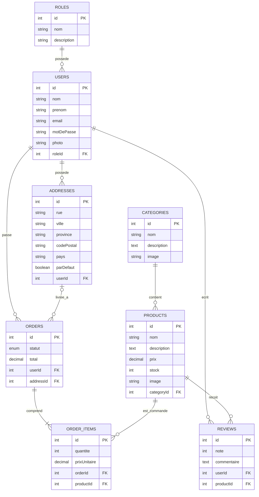

# Boutique API — Projet de conception de serveur web

API REST (Node.js / Express / Sequelize / MySQL / JWT) d'une boutique en ligne.

## Installation

```bash
npm install
cp .env.example .env        # puis modifier les identifiants MySQL
# créer la base :  CREATE DATABASE boutique_db;
npm run seed                # crée les tables, les rôles, un admin et des données de test
npm run dev                 # http://localhost:3000
```

Compte admin de test : `admin@boutique.com` / `Admin123!`

## Modèle entité-associations (à reproduire dans Lucidchart)



Diagrammes en image : `docs/modele-entite-associations.png` et `docs/modele-physique.png`.

Relation N–N Commande ↔ Produit résolue par la table `order_items`.

## Répartition (équipe de 4, 2 tables chacun)

| Membre | Tables | Fichiers |
|---|---|---|
| 1 – _(nom)_ | roles, users (+ auth JWT) | authController, roleController, userController |
| 2 – _(nom)_ | categories, products | categoryController, productController |
| 3 – _(nom)_ | orders, order_items | orderController |
| 4 – _(nom)_ | reviews, addresses | reviewController, addressController |

## Routes principales (préfixe `/api`)

| Ressource | Routes | Accès |
|---|---|---|
| auth | POST `/auth/register`, POST `/auth/login`, GET `/auth/me` | public / connecté |
| roles | CRUD `/roles` | admin |
| users | GET/POST/DELETE `/users`, PUT `/users/:id` | admin (PUT : soi-même ou admin) |
| categories | GET `/categories` public ; POST/PUT/DELETE | admin |
| products | GET `/products?page&limit&q&categoryId&minPrix&maxPrix` public ; POST/PUT/DELETE | admin |
| orders | GET, POST (`addressId` optionnel), PATCH `/:id/cancel`, PATCH `/:id/status`, DELETE | connecté / admin |
| reviews | GET public ; POST/PUT/DELETE | connecté (propriétaire ou admin) |
| addresses | GET `/addresses?page&limit`, GET/PUT/DELETE `/addresses/:id`, POST | connecté (ses adresses ; admin : toutes) |

Pagination : `?page=1&limit=10` → `{ total, page, limit, totalPages, data }`.
Images : requêtes `multipart/form-data`, champ `image` (ou `photo` pour users), servies sur `/uploads/...`.

## Postman
Importer `postman/Boutique_API.postman_collection.json`, lancer **Auth > Login** (le token est enregistré automatiquement).

## Workflow GitHub conseillé
```bash
git init && git branch -M main
git checkout -b feature/auth        # une branche par membre / fonctionnalité
git commit -m "feat: authentification JWT"
git push -u origin feature/auth     # puis Pull Request -> merge dans main
```
Pensez à donner l'accès du dépôt au professeur.
